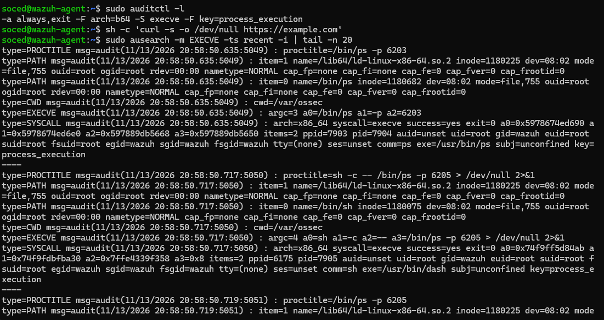
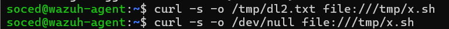
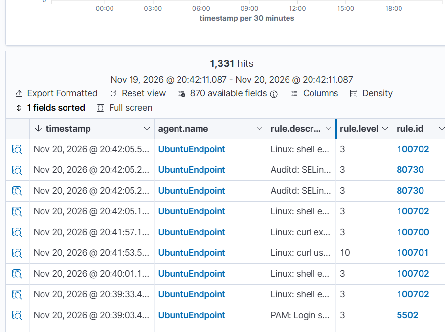
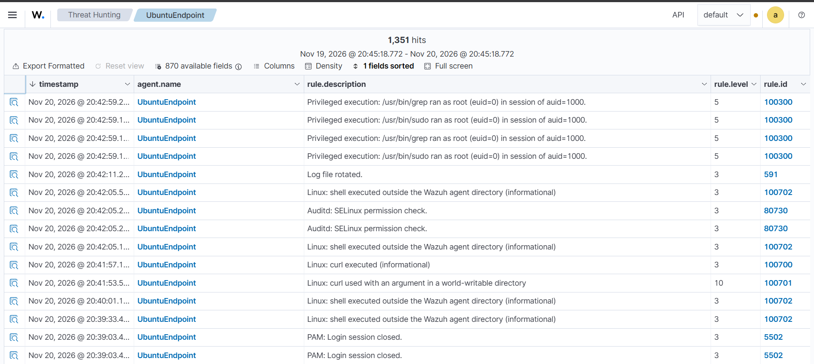
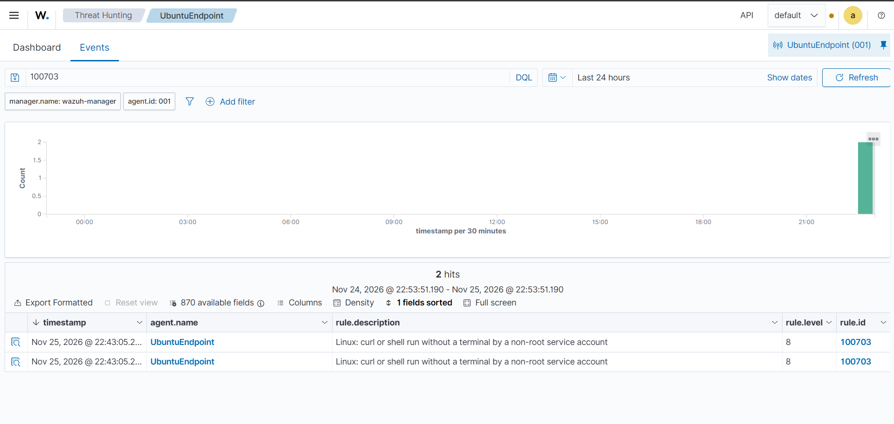
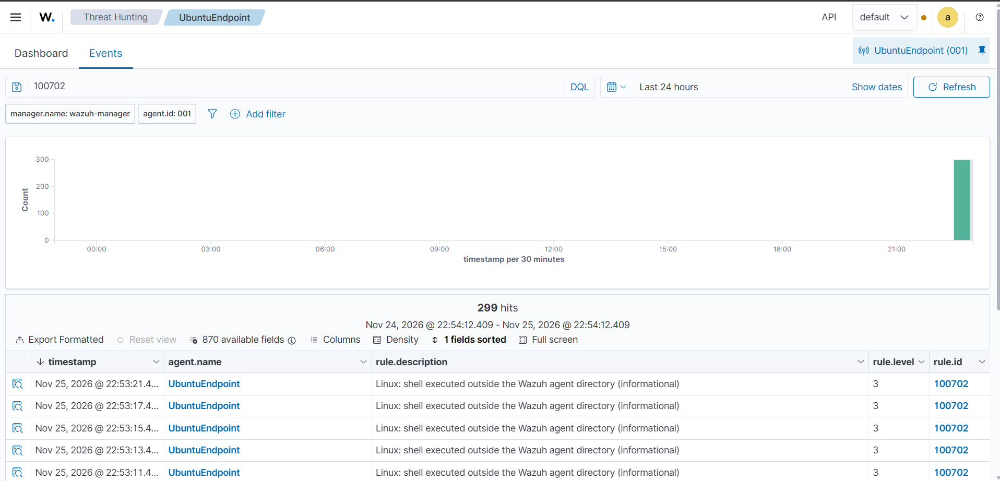
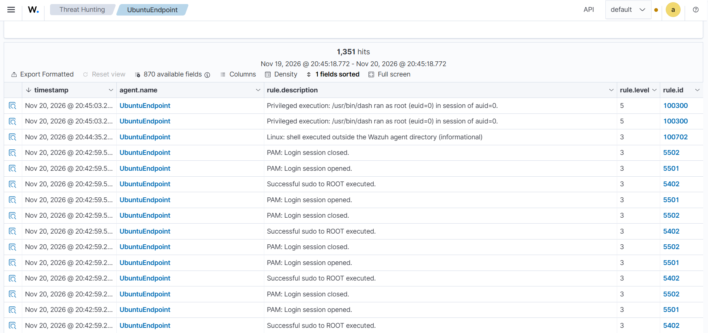
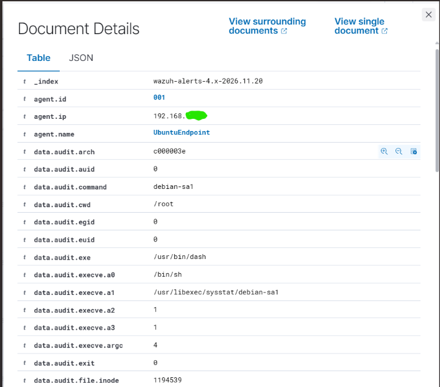
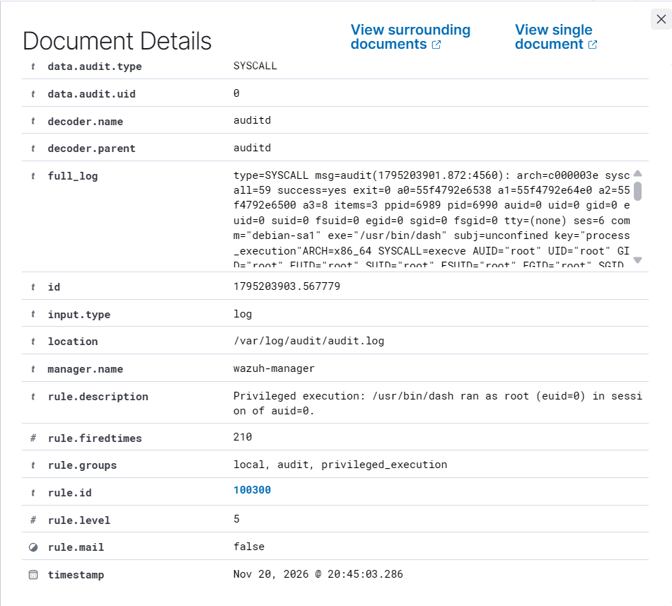

> **Environment.** Tested on Wazuh 4.14.10 with an Ubuntu endpoint running the Wazuh agent and auditd.

## 1. Introduction

Picture an attacker who has just logged in to a Linux server with a weak password. They need to bring in their next tool. Uploading malware is risky, because security software may recognize it. So they use curl, a program that is already installed and that administrators run every day.

Nothing new is written to disk and the program doing the work is legitimate, so a scanner that looks for known malware sees nothing wrong. This is an illustrative scenario, not an incident from my lab.

This guide shows how to build detection for this kind of activity with Wazuh and auditd. We start from raw process execution events, find out which of them are noise, and write rules that use arguments and user context instead of alerting on every execution.

## 2. What are LOLBins?

The technique is called living off the land: using the tools that already exist on the system. The programs involved are known as LOLBins (Living Off the Land Binaries). On Linux, typical examples are shells such as sh and network tools such as curl.

Blocking curl is not an option, because people legitimately need it. The detection question changes from "is this program bad?" to "who ran it, from where, and with which arguments?". Wazuh can answer that question when it receives enough context about each execution.

## 3. How an event becomes an alert

Every process execution follows the same path:

1. auditd records it. The Linux audit daemon writes an entry each time a program is started.
1. The Wazuh agent forwards it. The agent reads the audit log and sends new lines to the Wazuh manager.
1. The manager decodes it. The auditd decoder splits the raw line into fields such as `audit.exe`, `audit.command`, `audit.uid`, `audit.cwd` and `audit.execve.a0`.
1. Rules evaluate it. A rule fires when the decoded event matches its conditions.
1. An alert is generated and shown in the dashboard.

The rules in this guide work at stage 4. They depend on stages 1 to 3 delivering clean, structured data, so we configure those first.

## 4. Lab environment

- Wazuh manager 4.14.10.
- One Ubuntu endpoint with the Wazuh agent and auditd installed.
- Commands marked [endpoint] run on the Ubuntu endpoint. Commands marked [manager] run on the Wazuh manager.

## 5. Step 1: Record every process execution with auditd

[endpoint] Create an audit rule that records every 64-bit `execve` system call, the call Linux uses to start a program. The rule goes in `/etc/audit/rules.d/10-process-execution.rules` and the key `process_execution` tags every event so it is easy to find later:

```text
-a always,exit -F arch=b64 -S execve -k process_execution
```

Load the rule (for example with `sudo augenrules --load`) and confirm that it is active:

```bash
sudo auditctl -l
-a always,exit -F arch=b64 -S execve -F key=process_execution
```

## 6. Step 2: Send the audit log to Wazuh

[endpoint] Tell the agent to read the audit log. Add this block to `/var/ossec/etc/ossec.conf`:

```xml
<localfile>
  <log_format>audit</log_format>
  <location>/var/log/audit/audit.log</location>
</localfile>
```

Restart the agent and check that it picked up the file:

```text
sudo systemctl restart wazuh-agent
sudo grep -a 'audit.log' /var/ossec/logs/ossec.log
wazuh-logcollector: INFO: (1950): Analyzing file: '/var/log/audit/audit.log'.
```

On the manager, events from this file are decoded by the built-in auditd decoder and grouped under the parent rule 80700. The custom rules below build on rule 80700 with if\_sid.

## 7. Step 3: Look at the raw events first

Before writing any rule, read what auditd actually records. Run a test command and search for the event:

```bash
sh -c 'curl -s -o /dev/null https://example.com'
sudo ausearch -m EXECVE -ts recent -i | tail -n 20
```

Figure 1 shows the output. Each execution is split over several records: SYSCALL (who, which executable, which terminal), EXECVE (the arguments), CWD (the working directory) and PATH. Wazuh joins them into one event with fields like `audit.exe`, `audit.uid`, `audit.auid`, `audit.tty`, `audit.cwd` and `audit.execve.a0` to aN.



*Figure 1: Raw auditd events on the endpoint (ausearch). The shell sh -c -- /bin/ps -p 6205 runs as root, group wazuh, from /var/ossec, with no terminal.*

Two details in this output matter for the rules:

- The shell in Figure 1 runs as uid root with group wazuh, in `/var/ossec`, with no terminal and an unset auid. A human typing in a session has a terminal such as pts1 and an auid equal to their user ID.
- Arguments that contain spaces or special characters are written in hexadecimal. For example, the argument 617564697463746C202D6C is the text `auditctl` -l. A rule that searches for plain text such as \| sh in an argument cannot match this.

## 8. Step 4: Find out which executions are noise

Shells are the most frequent LOLBin, so I checked who starts them before writing a rule for them.

First, the agent configuration. The agent itself runs a command on a timer. This is part of its `ossec.conf`:

```xml
<localfile>
  <command>auditctl -l</command>
  <frequency>60</frequency>
</localfile>
```

A command in a localfile block is started by the log collector through a shell (sh -c), so every minute the agent produces a shell execution of its own.

Second, a count of the audit log. In a 10-minute window the log held 586 `execve` records. The shell executions (`comm=sh`) in that window came from these users:

| User and group | Shell executions |
| --- | --- |
| root, group wazuh | 16 |
| my own user (soced) | 11 |
| root, group root | 3 |

More than half of the shells (16 of 30) belonged to the agent. Third, the parent process. The most common parent process ID for shells was 2480:

```text
ps -o pid,ppid,user,cmd -p 2480
  PID  PPID USER  CMD
 2480     1 root  /var/ossec/bin/wazuh-logcollector
```

So the shells with group wazuh were started by the Wazuh log collector. Finally, the raw event confirms it. The shell was started with sh -c -- and the hex argument decodes to the agent's own command:

```text
type=EXECVE ... argc=4 a0="sh" a1="-c" a2="--" a3=617564697463746C202D6C
python3 -c "print(bytes.fromhex('617564697463746C202D6C').decode())"
auditctl -l
```

The same pattern appears in Figure 1, where the shell runs `sh -c -- /bin/ps -p 6205` from `/var/ossec` as group wazuh. I did not trace which agent component starts that one.

Conclusion: a rule that alerts on every shell would mostly report the monitoring agent's own housekeeping. Three properties separate this traffic from interactive use: the working directory `/var/ossec`, the group wazuh, and the missing terminal. We use them in the rules.

## 9. Step 5: Design the rules

Five decisions shape the rules:

- Rule IDs. Wazuh reserves 100000 to 120000 for custom rules, so they do not collide with the built-in ruleset. I chose 100700 to 100703, which were not in use in my local rules.
- Severity follows evidence. Running curl or a shell is normal, so those events are informational (level 3). A higher level is used only when something suspicious is present.
- Match the executable, not the process name. The rules test `audit.exe`, the real path of the program. The process name (`audit.command`) can be changed by the program or by a script, as step 9 shows, while the executable path cannot.
- Command arguments. The high-severity curl rule fires only when an argument points into `/tmp`, `/var/tmp` or `/dev/shm`, directories any user can write to.
- User and execution context, part 1. The shell rule skips shells whose working directory is `/var/ossec`, where the agent runs its own commands.
- User and execution context, part 2. A person working in a session has a terminal and an auid equal to their user ID. A service has no terminal and an unset auid (4294967295). Rule 100703 uses this: a shell or curl run without a terminal by a non-root account is raised to level 8. This is how web-shell activity typically looks, for example a shell started by the web server account www-data.

[manager] The rules are saved in `/var/ossec/etc/rules/lolbins_rules.xml`:

```xml
<group name="lolbins,linux,audit,">

  <rule id="100700" level="3">
    <if_sid>80700</if_sid>
    <field name="audit.exe">^/usr/bin/curl$</field>
    <description>Linux: curl executed (informational)</description>
  </rule>

  <rule id="100701" level="10">
    <if_sid>100700</if_sid>
    <regex type="pcre2">a\d+="(/tmp/|/var/tmp/|/dev/shm/)</regex>
    <description>Linux: curl used with an argument in a world-writable directory</description>
    <mitre>
      <id>T1105</id>
    </mitre>
  </rule>

  <rule id="100702" level="3">
    <if_sid>80700</if_sid>
    <field name="audit.exe" type="pcre2">^/usr/bin/(ba|da|z)?sh$</field>
    <field name="audit.cwd" negate="yes">^/var/ossec</field>
    <description>Linux: shell executed outside the Wazuh agent directory (informational)</description>
  </rule>

  <rule id="100703" level="8">
    <if_sid>100700, 100702</if_sid>
    <field name="audit.auid">^4294967295$</field>
    <field name="audit.uid" negate="yes">^0$</field>
    <regex type="pcre2">tty=\(none\)</regex>
    <description>Linux: curl or shell run without a terminal by a non-root service account</description>
    <mitre>
      <id>T1059</id>
    </mitre>
  </rule>

</group>
```

Rule 100702 uses `type="pcre2"` on `audit.exe`. The default Wazuh regular expression does not support the group (ba\|da\|z)? and the analysis daemon rejects the rule with a syntax error on the tag `audit.exe` unless the PCRE2 syntax is selected.

How the rules work:

- 100700 matches the executable `/usr/bin/curl` and raises an informational alert, so every curl execution stays visible.
- 100701 is a child of 100700. It fires only if an argument (a0, a1, a2 and so on) starts with a world-writable directory. Only this rule and 100703 carry a MITRE technique.
- 100702 matches a shell by its executable (sh, bash, dash or zsh under `/usr/bin`) and uses `negate="yes"` on `audit.cwd` to skip shells that run in `/var/ossec.`
- 100703 is a child of 100700 and 100702, so it only looks at curl and shell executions. It fires when auid is unset, the user is not root (negate on uid 0) and the raw event has `tty=(none`). Only the account name differs between a web server user and a login user, so no account list is needed.

## 10. Step 6: Deploy and check the syntax

[manager] Set the ownership and permissions that Wazuh expects, then let the analysis daemon check the whole ruleset before restarting:

```bash
sudo chown root:wazuh /var/ossec/etc/rules/lolbins_rules.xml
sudo chmod 660 /var/ossec/etc/rules/lolbins_rules.xml
sudo /var/ossec/bin/wazuh-analysisd -t
sudo systemctl restart wazuh-manager
```

A syntax error in the new file would be reported at this step, before the manager is restarted.

## 11. Step 7: Test with wazuh-logtest

[manager] `wazuh-logtest` runs a log line through the decoders and rules without generating an alert. Start it with sudo `/var/ossec/bin/wazuh-logtest` and paste one complete audit event (the full\_log of a real alert) per test. These were my results:

| Test event | Result in `wazuh-logtest` |
| --- | --- |
| curl -s file://`/tmp/x.sh` | Rule 100700, level 3 |
| curl -s -o `/tmp/dl.txt` file://`/tmp/x.sh` | Rule 100701, level 10 |

The first curl line does not trigger 100701 because its argument starts with file://`/tmp` and not with `/tmp/.`

## 12. Step 8: Test end to end

[endpoint] With the manager restarted, run the two curl commands on the endpoint (Figure 2):

```bash
curl -s -o /tmp/dl2.txt file:///tmp/x.sh
curl -s -o /dev/null file:///tmp/x.sh
```



*Figure 2: The two test commands run on the endpoint: one writes to /tmp, the other writes to /dev/null.*

In the dashboard (Threat Hunting, endpoint events) the first command produced rule 100701 at level 10, and the second produced rule 100700 at level 3 (Figure 3). The same two alerts are visible in the complete event list in Figure 4.



*Figure 3: Events for the test at 20:41: rule 100701 (level 10) for curl writing to /tmp, then rule 100700 (level 3) for the plain curl, followed by rule 100702 entries for shells.*



*Figure 4: The same test in the full event list. Rule 100701 (level 10) and rule 100700 (level 3) are separate entries, next to informational 100702 alerts and alerts from another rule in my local ruleset.*

The result is the behavior we wanted: both executions are recorded, but only the one with an argument in a world-writable directory is raised to level 10 and tagged with T1105.

Now the shell rule and the service-account rule. [endpoint] I started shells from my own login session, and one shell as the web server account www-data through systemd, which gives it no terminal and an unset auid:

```bash
sh -c 'echo test'
bash -c 'echo test'
sudo systemd-run --uid=www-data --wait /bin/sh -c 'curl -s -o /dev/null file:///tmp/x.sh'
```

The curl inside the third command exits with status 37, because www-data cannot read `/tmp/x.sh.` This does not matter for the test: auditd records the start of the program whether or not it succeeds.

[manager] Reading the alerts from `/var/ossec/logs/alerts/alerts.json`:

```text
2026-11-25T22:43:05 100703 level 8 /usr/bin/dash uid 33 auid 4294967295
2026-11-25T22:43:05 100703 level 8 /usr/bin/curl uid 33 auid 4294967295
2026-11-25T22:43:33 100702 level 3 /usr/bin/bash uid 1000 auid 1000
2026-11-25T22:43:41 100702 level 3 /usr/bin/dash uid 1000 auid 1000
```

Rule 100703 fired for both the shell and curl started by www-data (Figure 5). Rule 100702 fired for shells in my own session, and it recognizes bash and dash by their executable path (Figure 6).



*Figure 5: Events for rule.id 100703: two level 8 alerts at 22:43:05, one for the shell and one for curl started as www-data.*



*Figure 6: Events for rule.id 100702: informational level 3 shell alerts, one about every two seconds in the last chart bar (299 hits).*

To check the exclusion for the agent, I counted the 100702 alerts whose working directory is `/var/ossec.` After the manager restart there were 94 alerts of rule 100702 in total and none of them came from `/var/ossec`:

```bash
sudo grep -a '"id":"100702"' /var/ossec/logs/alerts/alerts.json | grep -a -c '"cwd":"/var/ossec"'
0
```

## 13. Step 9: Triage a repeating alert from its audit fields

This step is an example of the triage method, not part of the rule set above. My manager also runs a local rule that raises a level 5 alert whenever a program runs as root (`euid=0`) and reports the session's auid in its description. That rule is not shown here, and you do not need it: any alert that carries the audit fields can be triaged the same way.

Figure 7 shows alerts of that rule for `/usr/bin/dash` with `auid=0`. An auid of 0 means the session was not started by my login user, whose auid is 1000. I opened one of them to find out what it is (Figures 8 and 9).



*Figure 7: Level 5 alerts for /usr/bin/dash in a session with auid=0 (20:45:03), listed above an informational shell alert (20:44:35).*

The command is debian-sa1, the executable is `/usr/bin/dash`, the working directory is `/root`, and the arguments are `/bin/sh` and `/usr/libexec/sysstat/debian-sa1.` This is the sysstat collection script, which means a routine system job and not an attacker. The alert had fired 210 times by then.



*Figure 8: Alert details for one of the dash events: command debian-sa1, exe /usr/bin/dash, auid 0, cwd /root, arguments /bin/sh and /usr/libexec/sysstat/debian-sa1.*



*Figure 9: The same alert further down: the full audit event (comm debian-sa1, exe /usr/bin/dash, key process\_execution) and the rule data (level 5, fired 210 times).*

This is the same method as in step 4: read the fields, find the source, and decide what to exclude or lower. The details also show that the process name (`comm=debian-sa1`) can differ from the executable (`exe=/usr/bin/dash`). That is why the shell rule matches `audit.exe` and not `audit.command`: a rule on the process name would not see this shell, while a rule on the executable path does.

## 14. Step 10: Find what generates repeated informational alerts

Figure 6 shows a new pattern: rule 100702 fires about every two seconds. I applied the method from step 4 to this alert. [manager] First the fields of one of the alerts with exe `/usr/bin/bash`:

```text
sudo grep -a '"id":"100702"' /var/ossec/logs/alerts/alerts.json | grep -a '/usr/bin/bash' | tail -n 1 | python3 -c "import sys,json; a=json.loads(sys.stdin.read())['data']['audit']; print({k:a.get(k) for k in ['command','ppid','pid','cwd','tty','execve']})"

command: gpu-2604-wrappe   ppid: 3939   tty: (none)
cwd: /var/snap/snapd-desktop-integration/403
a0: /bin/bash
a1: /snap/snapd-desktop-integration/403/snap/command-chain/gpu-2604-wrapper
a4: /snap/snapd-desktop-integration/403/usr/bin/snapd-desktop-integration
```

The arguments point to snapd-desktop-integration, a helper of the Ubuntu desktop that is installed as a snap. [endpoint] Then the parent process and the state of the service:

```text
ps -o pid,ppid,user,cmd -p 3939
  PID  PPID USER   CMD
 3939     1 soced  /usr/lib/systemd/systemd --user

systemctl --user --no-pager status 'snap.snapd-desktop-integration*'
  Active: activating (auto-restart) (Result: exit-code)
  Process: ExecStart=/usr/bin/snap run snapd-desktop-integration (code=exited, status=3)

systemctl --user show 'snap.snapd-desktop-integration*' -p NRestarts -p Restart
Restart=on-failure
NRestarts=136
```

The user's systemd manager starts the service, the service exits with status 3, and systemd restarts it (Restart=on-failure). At the time of the check it had been restarted 136 times. Every start runs the bash wrapper, so every start becomes one 100702 alert. I did not investigate why the service exits with status 3.

Two conclusions follow. First, the rules behave as designed. The alert stays informational (level 3), and rule 100703 does not fire, because these shells run in my user session with auid 1000 and not as a service with an unset auid. Second, a failing service can create a steady stream of alerts. If this were a production host, the right next step would be to fix or exclude the service, and I left the rule unchanged in this lab.

## 15. MITRE ATT&CK mapping

MITRE ATT&CK describes what an attacker can do with a technique. It does not say that every use of the underlying tool is an attack. T1059 (Command and Scripting Interpreter) covers shells and T1105 (Ingress Tool Transfer) covers bringing tools onto a system. Administrators use both every day.

For that reason the mapping in these rules is deliberately narrow. The informational rules 100700 and 100702 carry no technique, because on their own they are context and not evidence. Rule 100701, curl with an argument in a world-writable directory, carries T1105. Rule 100703, a shell or curl run by a service account without a terminal, carries T1059. A tag tells an analyst which behavior to look at, and it does not mean that an attack happened.

## 16. The impact of monitoring every process execution

The audit rule records every program that starts, so it produces a lot of data. I measured it on the endpoint, a desktop VM:

- 586 `execve` records in about 10 minutes, while I was also typing investigation commands.
- In a quiet 10-minute period, `audit.log` grew from 6,735,732 to 6,799,340 bytes, an increase of 63,608 bytes (about 62 KB).
- Audit log files rotate at about 8 MB. Five files held 39 MB in total.

These are two samples from different moments, not an average, and activity changes the numbers a lot. The cost is more than disk space. Every record is read by the agent, sent to the manager, decoded and checked against the rules. A busy server with package installs, cron jobs and scripts will produce far more than an idle desktop.

- A service in a restart loop (step 10) produced 299 informational shell alerts between the manager restart at 22:42 and 22:54, most of them from that one service.

To reduce the load, narrow the audit rule (for example to specific users or programs) and keep Wazuh rules specific and informational where the event is normal. I did not test audit-level filters in this lab.

## 17. Summary

Attackers often use tools that are already on the system, so detection depends on context: who ran a command, from where, and with which arguments. In this lab, a large share of shell executions came from the Wazuh agent itself. Reading the raw audit events and tracing the parent process made it possible to separate that traffic from interactive use. The resulting rules use the recommended ID range, informational severity for normal activity, and a higher level only for curl with a suspicious argument or for a shell or curl run by a service account without a terminal. The result is fewer alerts and more meaning per alert.

## References

### Sources and further reading

- Wazuh documentation, Custom rules (rule ID range 100000 to 120000): <https://documentation.wazuh.com/current/user-manual/ruleset/rules/custom.html>
- MITRE ATT&CK, T1059: Command and Scripting Interpreter: <https://attack.mitre.org/techniques/T1059/>
- MITRE ATT&CK, T1105: Ingress Tool Transfer: <https://attack.mitre.org/techniques/T1105/>
- Wazuh documentation, Monitoring execution of malicious commands (a related guide using auditd): <https://documentation.wazuh.com/4.14/proof-of-concept-guide/audit-commands-run-by-user.html>
